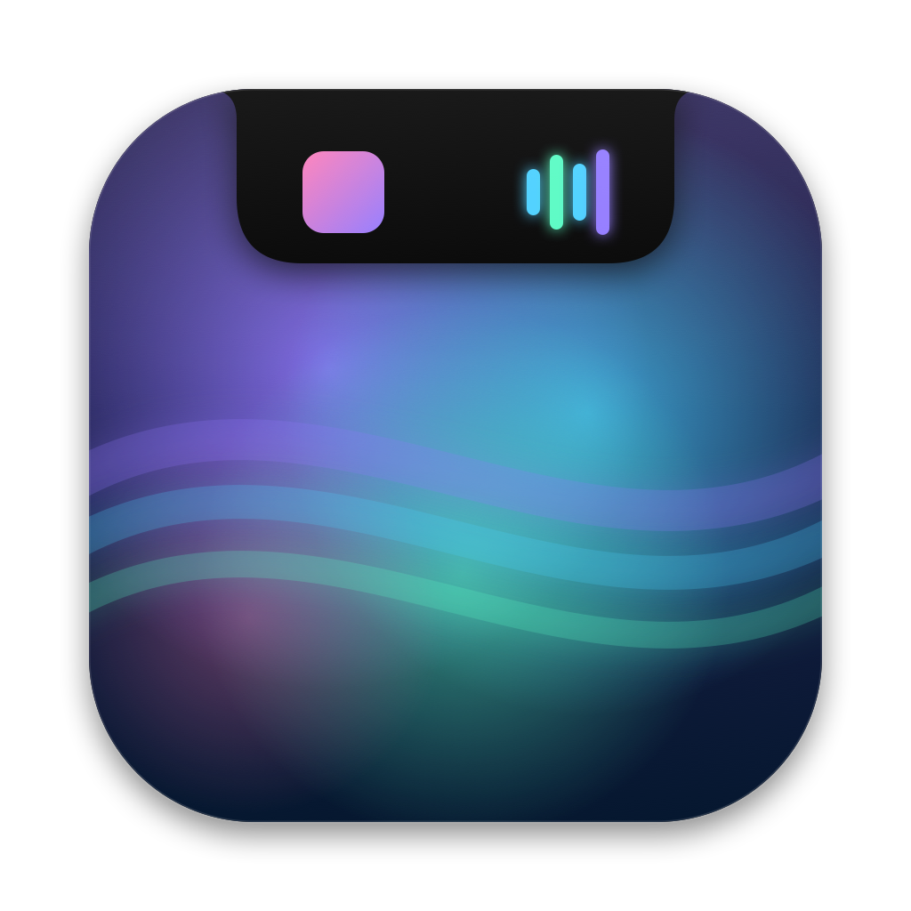
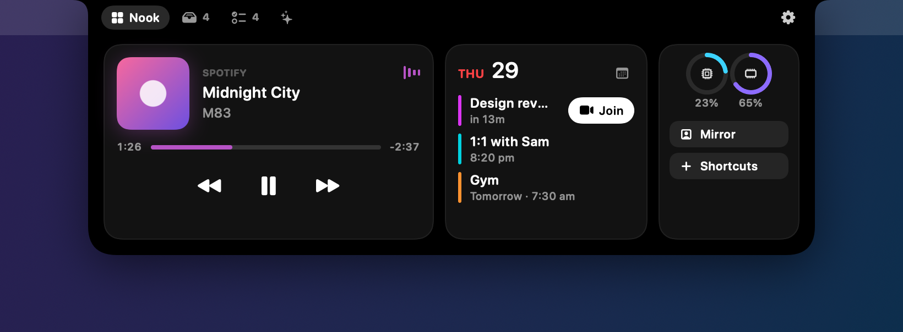
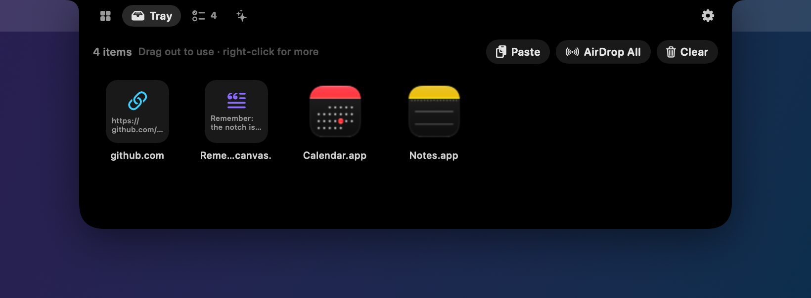
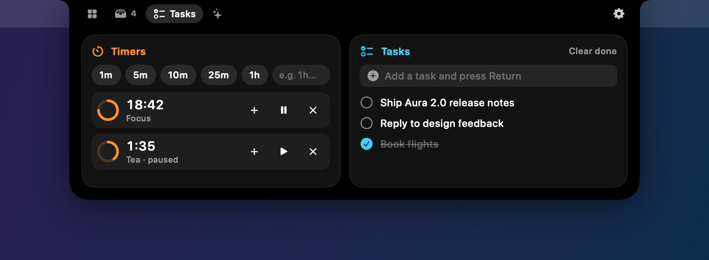
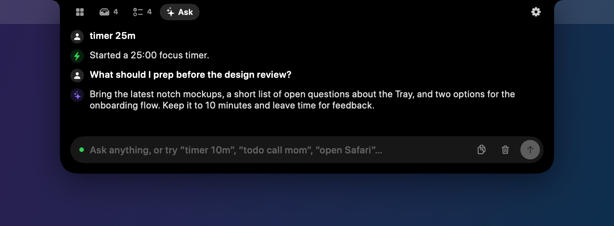
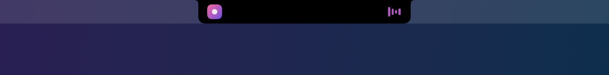
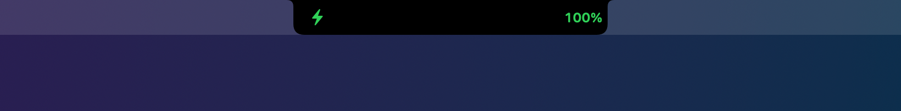
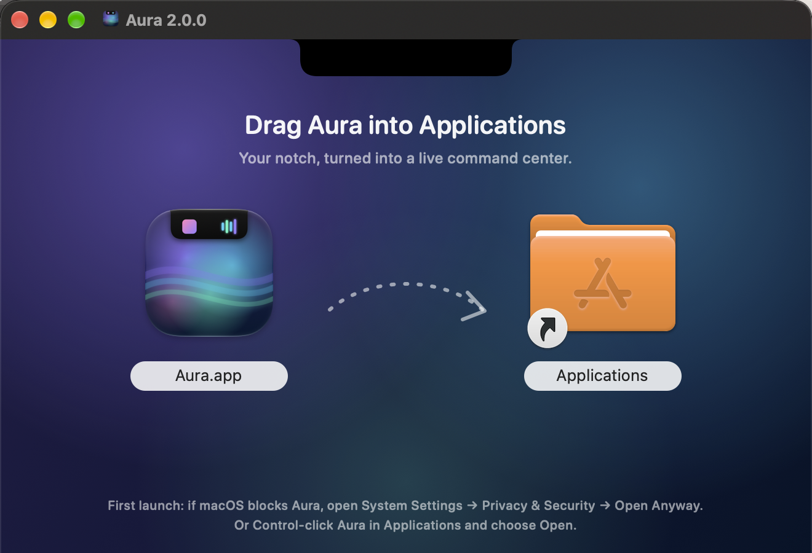

<p align="center">
  
</p>

<h1 align="center">Aura</h1>

<p align="center">
  <b>Your MacBook's notch, turned into a live command center.</b><br>
  Now playing, calendar, timers, a file tray with AirDrop, quick tasks and a local AI assistant, all living in the notch.
</p>

<p align="center">
  <a href="https://github.com/pronzzz/aura/releases/latest"></a>
  
  
  
  
</p>

<p align="center">
  
</p>

---

## Contents

- [Highlights](#highlights)
- [Screenshots](#screenshots)
- [Install](#install)
- [Using Aura](#using-aura)
- [Live activities](#live-activities)
- [The Ask tab](#the-ask-tab)
- [Automation](#automation)
- [Keyboard shortcuts and URLs](#keyboard-shortcuts-and-urls)
- [Settings](#settings)
- [Permissions](#permissions)
- [Privacy](#privacy)
- [Build from source](#build-from-source)
- [Architecture](#architecture)
- [Troubleshooting](#troubleshooting)
- [Contributing](#contributing)
- [License](#license)

## Highlights

| | |
|---|---|
| 🎵 **Now playing** | Artwork, scrubber and controls for Spotify and Apple Music. Album-tinted spectrum bars sit beside the notch while music plays. |
| 🗓 **Calendar** | Today's and tomorrow's events with a one-click **Join** button for Zoom, Meet, Teams, Webex, FaceTime and more. |
| 📥 **Tray + AirDrop** | Drag anything to the notch to stash it. Drag it back out later, or drop it on the AirDrop target to send it. Files, text, images and links are all supported. |
| ⏱ **Timers & tasks** | Multiple timers with a live countdown in the notch, plus a lightweight to-do list. |
| ✨ **Ask** | Instant quick commands that work offline, plus a streaming local AI assistant through [Ollama](https://ollama.com). Nothing leaves your Mac. |
| ⚡️ **Live activities** | Charging, low battery, timers and music show as compact wings around the notch. |
| 👀 **Quick Peek** | Track changes, power events and upcoming meetings slide briefly out of the notch, then tuck away. |
| 🖐 **Gestures** | Swipe down on the notch to open it, and swipe sideways to skip tracks. Drags open the tray automatically. |
| 🪞 **Mirror** | A quick camera check before you join a call. |
| 🔁 **Automation** | Local "when this, do that" workflows: battery, charger, apps, time of day and meetings drive notifications, Shortcuts, timers, AppleScript and more. |
| 🖥 **Any Mac** | Fits the real notch exactly. On Macs or displays without a notch, a matching virtual notch appears. Hides itself during fullscreen. |

## Screenshots

<table>
  <tr>
    <td></td>
    <td></td>
  </tr>
  <tr>
    <td align="center"><b>Tray</b>: stash, drag out, AirDrop</td>
    <td align="center"><b>Tasks</b>: timers and to-dos</td>
  </tr>
  <tr>
    <td></td>
    <td></td>
  </tr>
  <tr>
    <td align="center"><b>Ask</b>: quick commands and local AI</td>
    <td align="center"><b>Quick Peek</b>: song changed</td>
  </tr>
</table>

Closed-notch live activities:

<p>
  
  
  
</p>

## Install

1. Download **`Aura-2.0.0.dmg`** from the [latest release](https://github.com/pronzzz/aura/releases/latest).
2. Open it and drag **Aura** into **Applications**.

   

3. Launch Aura. A short welcome window walks you through the permissions.

> [!IMPORTANT]
> Aura is open source and ad-hoc signed, not notarized by Apple. The first time you open it, macOS may say it can't verify the developer. To allow it, use either of these:
> - **System Settings → Privacy & Security**, scroll down, then click **Open Anyway** next to Aura.
> - Or **Control-click** Aura in Applications, choose **Open**, then confirm.
>
> If you prefer, you can remove the quarantine flag from Terminal instead: `xattr -dr com.apple.quarantine /Applications/Aura.app`

**Requirements:** macOS 14 Sonoma or later, on Apple silicon or Intel. A notch is optional.

## Using Aura

| Do this | To |
|---|---|
| Hover over the notch | Open it. The delay is adjustable, or you can turn hover off. |
| Move the pointer away | Close it |
| Swipe down with two fingers on the notch | Open it without hovering |
| Swipe left/right on the notch | Skip to the next or previous track |
| Drag a file, text, image or link toward the notch | Open the Tray and drop it in |
| Drag an item out of the Tray | Use it anywhere: Finder, Mail, Slack, a browser upload… |
| Drop on **AirDrop** | Send it to a nearby device |
| Press `Esc` | Close the notch |
| Click the menu bar icon | Open the menu with tabs, settings, update check and quit |

The open notch has four tabs:

- **Nook**: media, calendar, system stats, Mirror and your favorite Shortcuts.
- **Tray**: stashed items. Use Paste, AirDrop All, Clear, and right-click for more.
- **Tasks**: timer presets (or type any duration, such as `1h 15m`) and a to-do list.
- **Ask**: quick commands and the local assistant.

Aura can reopen your last-used tab, or always start on a tab you choose.

## Live activities

When the notch is closed, Aura grows small "wings" on each side to show what's happening. Priority order:

1. **Timer**: progress ring and countdown.
2. **Charging**: battery level as the charger connects. It lingers for a few seconds.
3. **Low battery**: appears below your threshold (20% by default).
4. **Music**: artwork on the left and spectrum bars on the right, tinted by the album art.

**Quick Peek** briefly expands the notch for a song change, plugging in or unplugging, a finished timer, or a calendar event that starts in 5 minutes (the lead time is configurable). Each peek type can be turned off.

## The Ask tab

Ask understands common commands instantly, with no AI and no network:

| Type | Does |
|---|---|
| `timer 10m`, `start a 1h 30m timer`, `pomodoro`, `focus 45m` | Starts a timer |
| `todo call mom`, `remind me to send the invoice` | Adds a task |
| `play`, `pause`, `next`, `previous` | Controls music |
| `open Safari`, `launch Figma` | Opens an app |
| `what's next?`, `next meeting` | Shows your next event |
| `battery` | Shows charge and time remaining |
| `run shortcut Morning` | Runs an Apple Shortcut |
| `clear tray`, `settings` | Does exactly that |

Anything else goes to your **local** model through Ollama. Answers stream into the notch, and Aura passes along light context (the time, your next event, what's playing) so answers can be relevant. The clipboard chips **Summarize**, **Explain** and **Fix grammar** act on whatever you've copied.

Set up the AI part once:

```bash
brew install ollama
ollama serve            # or open the Ollama app
ollama pull llama3.2
```

You can change the server URL and model in **Settings → Assistant**, and use **Test Connection** there to check it. In the Ask tab, the dot next to the input turns green when Ollama is reachable.

## Automation

**Settings → Automation** lets you build simple workflows that run entirely on your Mac.

**Triggers:** battery drops below X%, charger connected or disconnected, an app launches or quits, a time of day, a meeting starting soon, Aura launches.

**Actions:** show a notification, show a Quick Peek, open an app, open a URL, run a Shortcut, start a timer, add a task, play/pause, pause music, open the notch, run AppleScript.

Templates to start from: *Low battery warning*, *Meeting heads-up*, *Deep work with Xcode*, *Morning start*, *Unplugged reminder*.

## Keyboard shortcuts and URLs

| Shortcut | Action |
|---|---|
| `⌃⌥N` | Toggle the notch |
| `⌃⌥A` | Open Ask, ready to type |

You can turn the global shortcuts off in **Settings → General**.

Aura also handles `aura://` links, which are handy from Shortcuts, Raycast, Alfred or scripts:

```bash
open aura://open        # open the notch
open aura://ask
open aura://tray
open aura://tasks
open aura://settings
```

## Settings

| Section | What's there |
|---|---|
| General | Launch at login, menu bar icon, which displays get a notch, fullscreen hiding, global shortcuts, update checks |
| Notch & Gestures | Hover to open and its delay, default or last tab, trackpad gestures, haptics, virtual notch on displays without one |
| Live Activities | Which activities appear, linger time, low-battery threshold, Quick Peek types and meeting lead time, a preview button |
| Media | Album-coloured visualizer, opt-in browser detection for YouTube Music and Spotify Web |
| Tray | Show the Tray folder, clear the Tray |
| Shortcuts | Pick favourite Apple Shortcuts for the Nook tab |
| Assistant | Ollama URL, model picker, connection test, quick-command reference |
| Automation | Create, edit, enable and delete workflows, or start from a template |
| Permissions | Live status and one-click fixes for Calendar, Automation and Camera |
| About | Version, release notes, issue reporting, show the welcome screen again |

## Permissions

Aura asks only for what a feature needs, when you first use it:

| Permission | Used for |
|---|---|
| **Automation** (Spotify, Music, optional browsers) | Reading the current track and sending play, pause and skip |
| **Calendars** | Showing events and meeting links |
| **Camera** | Mirror only. Aura doesn't record anything. |

You can check or fix any of them in **Settings → Permissions**.

## Privacy

- No analytics, no tracking, no account.
- The AI runs locally through Ollama. Quick commands don't use AI at all.
- Tray items live in `~/Library/Application Support/Aura/Tray/` on your Mac.
- The only network call Aura makes by itself is the optional update check, which hits GitHub's public releases API.

## Build from source

Requires Xcode 16+ and [XcodeGen](https://github.com/yonaskolb/XcodeGen).

```bash
git clone https://github.com/pronzzz/aura.git
cd aura
brew install xcodegen
xcodegen generate
open Aura.xcodeproj
```

Useful scripts:

```bash
# Build a universal, signed app and package dist/Aura-<version>.dmg (needs: brew install create-dmg)
./scripts/release.sh

# Regenerate the app icon and installer background
swift scripts/make_art.swift icon docs/art/icon-1024.png
swift scripts/make_art.swift dmg docs/art/dmg-background.png 1
swift scripts/make_art.swift dmg docs/art/dmg-background@2x.png 2

# Render README screenshots with demo data (no permissions or real data used)
/path/to/Aura.app/Contents/MacOS/Aura --snapshot docs/screenshots
```

`project.yml` is the source of truth. Edit it rather than the generated project when you add files or change settings.

## Architecture

```
Aura/
├── App/            Entry point, AppDelegate, menu bar item, URL scheme, Info.plist
├── Core/           Notch geometry, panel, view model, per-screen controller,
│                   coordinator, hotkeys, fullscreen monitor, snapshot renderer
├── Services/       Now playing, power, calendar, timers/todos/shortcuts,
│                   tray store, camera, system stats, update checker, activity center
├── AI/             Ollama client, quick-command parser, assistant
├── Automation/     Workflow model and engine
└── Views/          Notch shape and root, tabs, settings, onboarding, shared components
```

Key design decisions:

- **One fixed-size panel per screen.** Only the SwiftUI shape inside it animates, so opening and closing never resizes a window. The panel passes clicks through unless the pointer is over the visible notch, so menu bar items next to it keep working.
- **First-click controls.** The hosting view accepts the first mouse click, so buttons respond even while Aura isn't the active app.
- **Exact notch fit.** The size comes from `auxiliaryTopLeftArea` / `auxiliaryTopRightArea`. Screens without a notch get a matching virtual notch.
- **Event-driven services.** Power uses IOKit notifications, music uses distributed notifications plus AppleScript on a background queue, and calendar uses EventKit change notifications, so there's no constant polling.
- **ActivityCenter** chooses the single most important live activity and schedules Quick Peeks.

## Troubleshooting

- **"Aura can't be opened."** See the Gatekeeper note in [Install](#install).
- **No music info.** Allow Automation for Spotify or Music in **System Settings → Privacy & Security → Automation**, or use **Settings → Permissions**.
- **Calendar is empty.** Grant Full Calendar Access, and make sure the calendars are enabled in the Calendar app.
- **The Ask tab says Ollama isn't reachable.** Run `ollama serve` and pull a model. Check the URL in **Settings → Assistant**.
- **The notch doesn't open on hover.** Check **Settings → Notch & Gestures**, or use `⌃⌥N`.

## Contributing

Issues and pull requests are welcome. For a larger change, please open an issue first so we can talk about the approach.

1. Fork and create a branch.
2. Run `xcodegen generate` after adding files.
3. Keep features local-first and permission-light.
4. If your change affects the UI, update the screenshots with `--snapshot`.

## Acknowledgements

Aura's 2.0 feature set came out of studying how modern notch utilities, NotchNook in particular, approach live activities, the tray, gestures and Quick Peek. All of Aura's code, art and design are original.

## License

[MIT](LICENSE) © 2026 Pranav Dwivedi
